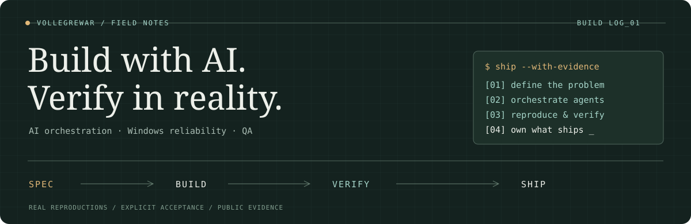
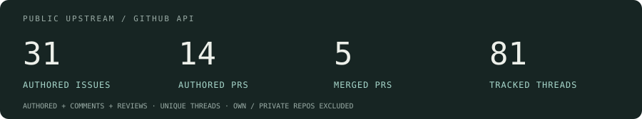

  

  <a href="#selected-work">Selected work</a> &nbsp; / &nbsp;
  <a href="#open-source-evidence">Open-source evidence</a> &nbsp; / &nbsp;
  <a href="#contribution-log">Contribution log</a>

I'm **vollegrewar**, an AI-native builder with a professional QA background. I turn requirements into working systems, orchestrate coding agents, reproduce failures, and set the acceptance bar. **AI authors the implementation under my direction; I own the problem framing, course corrections, verification, and what ships.**

My open-source work often starts on a real Windows machine: an update that gets stuck, a subprocess that inherits the wrong environment, or a UI that hides its controls. I turn those failures into reproducible reports, verification evidence, and patches.

> **我的工作方式：** 定义问题 → 编排 AI → 真实环境复现与验证 → 对交付负责。

## Selected work

| Project | What it demonstrates |
|---|---|
| **[AI writing pipeline](https://github.com/vollegrewar/ai-writing-pipeline-demo)** | A reproducible long-form workflow: analysis → outline → chapter writing → review. Multi-model orchestration, consistency gates, style checks, and corpus engineering. |
| **[AnySearch for Hermes](https://github.com/vollegrewar/hermes-plugin-anysearch)** | Search and extraction providers with Exa / Firecrawl fallback chains. Accepted into the official Hermes plugin catalog. |
| **[Defect-driven API testing](https://github.com/vollegrewar/defect-driven-api-testing)** | FastAPI, pytest, independent contract checks, defect regression cases, and CI quality gates. |
| **[坑位图鉴 / personal job radar](https://github.com/vollegrewar/kengwei-tujian)** | A local job collection and scoring workflow, built on get-a-job with salary rules and an OpenAI-compatible scoring driver. |
| **[Hermes desktop toolkit](https://github.com/vollegrewar/hermes-desktop-toolkit)** | Process and exit audits, layered troubleshooting, and session / sidebar forensics. September 2026 snapshot. |
| **[Hermes upgrade guide](https://github.com/vollegrewar/hermes-upgrade-guide)** | Backups, local-change protection, upgrade-channel choices, and recovery checks. September 2026 snapshot. |

Also: [Windows terminal hygiene](https://github.com/vollegrewar/windows-terminal-hygiene) · [DSH tool highlight](https://github.com/vollegrewar/dsh-tool-highlight)

## Open-source evidence

Reports, patches, reviews, and verification have different roles. These are selected examples with links to the upstream record.

| Work | My contribution | Upstream state |
|---|---|---|
| **[Hermes · AnySearch catalog #112158](https://github.com/NousResearch/hermes-agent/pull/112158)** | Authored the catalog PR for my search / extraction plugin. | <!-- STATUS https://github.com/NousResearch/hermes-agent/pull/112158 -->🟣 Merged<!-- /STATUS --> |
| **[Hugging Face · mirror redirects #4637](https://github.com/huggingface/huggingface_hub/issues/4637)** | Reported the misleading download error and proposed a fix in [#4648](https://github.com/huggingface/huggingface_hub/pull/4648); the upstream fix landed in [#4739](https://github.com/huggingface/huggingface_hub/pull/4739). | Adopted upstream; #4739 merged |
| **[Hermes · subprocess isolation #82581](https://github.com/NousResearch/hermes-agent/pull/82581)** | Reproduced and retested on a Windows 11 junction install. The merged [#88285](https://github.com/NousResearch/hermes-agent/pull/88285) explicitly credits this verification. | Verification credited; #88285 merged |
| **[get-a-job · scoring & resume workflow #2](https://github.com/helsonxiao/get-a-job/pull/2)** | Authored resume-quality guidance, an OpenAI-compatible scoring driver, and three fixes. | <!-- STATUS https://github.com/helsonxiao/get-a-job/pull/2 -->🟣 Merged<!-- /STATUS --> |
| **[get-a-job · MIT license #4](https://github.com/helsonxiao/get-a-job/pull/4)** | Supplied the missing license file to match the README declaration. | <!-- STATUS https://github.com/helsonxiao/get-a-job/pull/4 -->🟣 Merged<!-- /STATUS --> |
| **[Hermes · 2× pet atlases #110721](https://github.com/NousResearch/hermes-agent/pull/110721)** | Authored a patch deriving sprite-cell dimensions from the atlas grid. | <!-- STATUS https://github.com/NousResearch/hermes-agent/pull/110721 -->🟢 Open<!-- /STATUS --> |
| **[Hermes · failed tool calls #114119](https://github.com/NousResearch/hermes-agent/pull/114119)** | Authored a patch to flag failed calls in the tool-complete frame. | <!-- STATUS https://github.com/NousResearch/hermes-agent/pull/114119 -->🟢 Open<!-- /STATUS --> |
| **[Hermes · update dialog at 125% scale #128170](https://github.com/NousResearch/hermes-agent/issues/128170)** | Reported inaccessible update controls, an invisible scrollbar, and a non-sticky footer. | <!-- STATUS https://github.com/NousResearch/hermes-agent/issues/128170 -->🟢 Open<!-- /STATUS --> |
| **[Hermes · desktop & upgrade skills #96](https://github.com/ZeroPointRepo/awesome-hermes-skills/pull/96)** | Submitted two troubleshooting / upgrade resources to the community directory. | <!-- STATUS https://github.com/ZeroPointRepo/awesome-hermes-skills/pull/96 -->🟢 Open<!-- /STATUS --> |
| **[DSH · settings API mismatch #2](https://github.com/Max-Null/dsh-node-appearance/issues/2)** | Traced the missing settings card to an unavailable `installSection` API. | <!-- STATUS https://github.com/Max-Null/dsh-node-appearance/issues/2 -->⚪ Closed<!-- /STATUS --> |

## Working toolkit

**Hands-on:** requirements & acceptance · agent orchestration · QA · Windows troubleshooting · ComfyUI · Ollama 
**Shipped implementation:** Python · JavaScript / TypeScript · FastAPI · pytest · Playwright / CDP · OpenCV · SQLite · Chrome MV3

<b>Additional engineering work</b> · previously shared project summaries

| Build | Engineering focus |
|---|---|
| Game rescue automation | Event-driven state machines, visual template matching, and recovery paths. |
| Corpus & data pipelines | UTF-8 / Big5 handling, routing, resumable collection, and forum adapters. |
| Local writing client | FastAPI + HTMX project / chapter registry and Playwright E2E checks. |
| Generation-pipeline tooling | ComfyUI workflows and nine-state sprite-sheet generation with pixel-level QA. |

## Contribution log

  

<!-- CONTRIB_BADGES -->

<!-- /CONTRIB_BADGES -->

**Scope:** public upstream repositories only; my own repositories and private work are excluded. Counts use unique issues / PRs. “Author” means I opened the item; “Participant” means I commented; “Reviewer” means a PR review. A closed issue does not by itself establish that the bug was fixed. These totals differ from GitHub's calendar contribution count.

<b>Hermes Agent</b> · reports, patches, and verification threads

<!-- CONTRIB_TABLE -->
| Contribution | Role | Title | Status |
|---|---|---|---|
| [NousResearch/hermes-agent #139061](https://github.com/NousResearch/hermes-agent/issues/139061) · Issue | Author | \[Bug\]: Pasting an image fails with invalid\_params in a non-default profile (attachment staged in the default profile&#x27;s cache) | ⚪ Closed |
| [NousResearch/hermes-agent #138940](https://github.com/NousResearch/hermes-agent/issues/138940) · Issue | Participant | \[Bug\]: Background process completion notifications fail delivery to Discord and spin in infinite retry injection loop | ⚪ Closed |
| [NousResearch/hermes-agent #129993](https://github.com/NousResearch/hermes-agent/issues/129993) · Issue | Participant | \[Bug\]: Desktop: assistant reply is rendered twice in the transcript (duplicate bubble), while the persisted transcript has a single row | 🟢 Open |
| [NousResearch/hermes-agent #128170](https://github.com/NousResearch/hermes-agent/issues/128170) · Issue | Author | \[Bug\]: Update dialog&#x27;s Update now / Maybe later buttons are undiscoverable at UI Scale &gt;=125% - the body scrolls, but the scrollbar is invisible and the footer is not sticky | 🟢 Open |
| [NousResearch/hermes-agent #127349](https://github.com/NousResearch/hermes-agent/issues/127349) · Issue | Participant | \[Bug\]: minimize-to-tray — restoring from the taskbar&#x27;s pinned icon gives a painted-but-dead window (still reproducible after #119252) | ⚪ Closed |
| [NousResearch/hermes-agent #122800](https://github.com/NousResearch/hermes-agent/issues/122800) · Issue | Author | \[Bug\]: \`pm/workspace.py\` writes \`pyproject.toml\` without transient-lock retry — one blocked write discards the whole dependency sync and leaves a permanent \`source-completion-pending\` marker (Windows) | 🟢 Open |
| [NousResearch/hermes-agent #122206](https://github.com/NousResearch/hermes-agent/issues/122206) · Issue | Participant | fix(desktop): recover when the backend becomes ready after an interrupted update exceeds startup wait | ⚪ Closed |
| [NousResearch/hermes-agent #120005](https://github.com/NousResearch/hermes-agent/issues/120005) · Issue | Participant | Desktop: chats on a non-default profile stream garbled text and show duplicate bubbles (two sockets to one backend) | ⚪ Closed |
| [NousResearch/hermes-agent #118901](https://github.com/NousResearch/hermes-agent/issues/118901) · Issue | Participant | \[Bug\]: Composer timer continues ticking after task completion | ⚪ Closed |
| [NousResearch/hermes-agent #118497](https://github.com/NousResearch/hermes-agent/issues/118497) · Issue | Author | \[Desktop\] Link-card title is mojibake for non-UTF-8 pages (Big5/GBK/Shift-JIS) — faviconIo.fetchText uses Response.text(), which always decodes as UTF-8 | ⚪ Closed |
| [NousResearch/hermes-agent #115027](https://github.com/NousResearch/hermes-agent/pull/115027) · PR | Participant | fix(desktop): answer batch clarify on request socket | 🟢 Open |
| [NousResearch/hermes-agent #114119](https://github.com/NousResearch/hermes-agent/pull/114119) · PR | Author | fix(tui\_gateway): flag failed tool calls on the tool.complete frame | 🟢 Open |
| [NousResearch/hermes-agent #113977](https://github.com/NousResearch/hermes-agent/issues/113977) · Issue | Author | \[Bug\]: Windows &#x27;hermes gateway start&#x27; installs login auto-start on non-interactive stdin - all three prompts default to Yes | ⚪ Closed |
| [NousResearch/hermes-agent #112158](https://github.com/NousResearch/hermes-agent/pull/112158) · PR | Author | catalog: add anysearch (community web search/extract plugin) | 🟣 Merged |
| [NousResearch/hermes-agent #110721](https://github.com/NousResearch/hermes-agent/pull/110721) · PR | Author | feat(pets): derive sprite cell size from the atlas grid | 🟢 Open |
| [NousResearch/hermes-agent #109680](https://github.com/NousResearch/hermes-agent/issues/109680) · Issue | Author | \[Bug\]: stale gateway\_state.json + PID reuse fabricates a phantom gateway runtime in the pre-update inventory — update exits 1 (partial) with &quot;no rows&quot; + &quot;never touched&quot; warnings | ⚪ Closed |
| [NousResearch/hermes-agent #108630](https://github.com/NousResearch/hermes-agent/issues/108630) · Issue | Author | \[Bug\] Auto-archive leaves the canonical &quot;Bot Chat&quot; with no recoverable end\_reason — permanent title deadlock not covered by #92687 / #92473 | ⚪ Closed |
| [NousResearch/hermes-agent #107823](https://github.com/NousResearch/hermes-agent/pull/107823) · PR | Participant | fix(desktop): restore minimized sessions from sidebar toggle | ⚪ Closed |
| [NousResearch/hermes-agent #107641](https://github.com/NousResearch/hermes-agent/pull/107641) · PR | Participant | fix(desktop): re-resolve session owners instead of surfacing ownerless runtime ids | ⚪ Closed |
| [NousResearch/hermes-agent #103793](https://github.com/NousResearch/hermes-agent/issues/103793) · Issue | Participant | \[Bug\]\[Windows\] Local STT fails: &quot;Library cublas64\_12.dll is not found or cannot be loaded&quot; — fix via CUDA 12 wheels in the venv (GPU) or forcing CPU | ⚪ Closed |
| [NousResearch/hermes-agent #102398](https://github.com/NousResearch/hermes-agent/issues/102398) · Issue | Author | \[Feature\]: Desktop Settings — a visible, per-profile approvals.mode selector | ⚪ Closed |
| [NousResearch/hermes-agent #98436](https://github.com/NousResearch/hermes-agent/issues/98436) · Issue | Author | \[Bug\]\[Windows\] hermes update hand-off child silently loses its update receipt after the catch-up module purge — console end state also looks hung | ⚪ Closed |
| [NousResearch/hermes-agent #90114](https://github.com/NousResearch/hermes-agent/pull/90114) · PR | Participant | feat(desktop): add project archive/restore to the sidebar | 🟢 Open |
| [NousResearch/hermes-agent #89662](https://github.com/NousResearch/hermes-agent/issues/89662) · Issue | Participant | \[Feature\]: Desktop — expose project archive/restore in the sidebar (CLI capability exists but no UI affordance) | 🟢 Open |
| [NousResearch/hermes-agent #86272](https://github.com/NousResearch/hermes-agent/pull/86272) · PR | Author | \[codex\] fix desktop profile project gateway routing | ⚪ Closed |
| [NousResearch/hermes-agent #86107](https://github.com/NousResearch/hermes-agent/issues/86107) · Issue | Author | \[Bug\]: Desktop — single explicit project entry vanishes from sidebar Projects list mid-session; survives restart (backend intact) | ⚪ Closed |
| [NousResearch/hermes-agent #83192](https://github.com/NousResearch/hermes-agent/issues/83192) · Issue | Author | Bug: find-in-page bar (Ctrl+F) overlaps native window controls on Windows — verified, covered by #80244 | ⚪ Closed |
| [NousResearch/hermes-agent #82689](https://github.com/NousResearch/hermes-agent/issues/82689) · Issue | Author | kanban: no operator audit on assign + dispatcher executes side-effectful tasks without authorization gate | 🟢 Open |
| [NousResearch/hermes-agent #82635](https://github.com/NousResearch/hermes-agent/issues/82635) · Issue | Author | \[Bug\]: Desktop Settings → Chat timezone dropdown truncates long IANA option names — popover width pinned to trigger | ⚪ Closed |
| [NousResearch/hermes-agent #82581](https://github.com/NousResearch/hermes-agent/pull/82581) · PR | Participant | fix(tools): isolate subprocess Python environments (#74817) | ⚪ Closed |
| [NousResearch/hermes-agent #82505](https://github.com/NousResearch/hermes-agent/pull/82505) · PR | Author | fix(desktop): deterministic title for untitled chat sessions | 🟢 Open |
| [NousResearch/hermes-agent #82202](https://github.com/NousResearch/hermes-agent/pull/82202) · PR | Participant | feat(web): native Exa advanced search + agent tools (no MCP) | 🟢 Open |
| [NousResearch/hermes-agent #80542](https://github.com/NousResearch/hermes-agent/issues/80542) · Issue | Author | \[Feature\]: Desktop — untitled sessions are unidentifiable (86% of sessions have NULL title; no meaningful fallback label) | 🟢 Open |
| [NousResearch/hermes-agent #80498](https://github.com/NousResearch/hermes-agent/issues/80498) · Issue | Author | Tool-call arguments silently replaced with empty object when stream dies mid-call — silent data loss, no retry (write\_file never executed) | ⚪ Closed |
| [NousResearch/hermes-agent #80244](https://github.com/NousResearch/hermes-agent/pull/80244) · PR | Participant | fix(desktop): keep the find bar clear of the window controls | ⚪ Closed |
| [NousResearch/hermes-agent #80204](https://github.com/NousResearch/hermes-agent/issues/80204) · Issue | Participant | \[Bug\]: Hermes Desktop leaves orphaned \`hermes serve\`, MCP watchdog, and daemon Python processes after exit/update | ⚪ Closed |
| [NousResearch/hermes-agent #80122](https://github.com/NousResearch/hermes-agent/pull/80122) · PR | Reviewer + Participant | fix(agent): handle auxiliary stream stalls and prevent turn ghosting | ⚪ Closed |
| [NousResearch/hermes-agent #78981](https://github.com/NousResearch/hermes-agent/issues/78981) · Issue | Author | Session permanently dies after repeated context-compression hangs (DeepSeek 500k-token session): stalled stream waits 600s ceiling, interrupted turn never recovers, later messages never start a turn | ⚪ Closed |
| [NousResearch/hermes-agent #77394](https://github.com/NousResearch/hermes-agent/issues/77394) · Issue | Participant | Windows: hermes update still fails on main — paused gateway keeps \_rust.pyd locked (fix #73684 does not cover respawned gateways) | 🟢 Open |
| [NousResearch/hermes-agent #77156](https://github.com/NousResearch/hermes-agent/pull/77156) · PR | Participant | feat(temperature): add per-session and global sampling temperature control | ⚪ Closed |
| [NousResearch/hermes-agent #76886](https://github.com/NousResearch/hermes-agent/issues/76886) · Issue | Participant | read\_file reports valid UTF-8 text as binary when the 1000-byte sample cuts a multibyte character (regression in 0.19.1) | ⚪ Closed |
| [NousResearch/hermes-agent #75334](https://github.com/NousResearch/hermes-agent/issues/75334) · Issue | Participant | Bug: Desktop self-update always aborts when a non-Desktop-owned gateway process holds the venv lock (Windows) | ⚪ Closed |
| [NousResearch/hermes-agent #74817](https://github.com/NousResearch/hermes-agent/issues/74817) · Issue | Participant | PYTHONPATH leaks into terminal-tool subprocesses on macOS/Linux, can crash unrelated third-party apps | ⚪ Closed |
| [NousResearch/hermes-agent #74443](https://github.com/NousResearch/hermes-agent/pull/74443) · PR | Participant | feat: honor model temperature configuration | 🟢 Open |
| [NousResearch/hermes-agent #67463](https://github.com/NousResearch/hermes-agent/pull/67463) · PR | Participant | fix(desktop): split sidebar into independent Projects + Sessions collapsible sections (#67368) | ⚪ Closed |
| [NousResearch/hermes-agent #59041](https://github.com/NousResearch/hermes-agent/pull/59041) · PR | Participant | fix: prevent credential pool poisoning from model-not-found 401s and api\_mode persistence | ⚪ Closed |
| [NousResearch/hermes-agent #51893](https://github.com/NousResearch/hermes-agent/pull/51893) · PR | Participant | fix(desktop): handle notification action indexes | ⚪ Closed |
| [NousResearch/hermes-agent #51444](https://github.com/NousResearch/hermes-agent/issues/51444) · Issue | Participant | \[Bug\]: Approval from notification doesn&#x27;t work | ⚪ Closed |
| [NousResearch/hermes-agent #46169](https://github.com/NousResearch/hermes-agent/issues/46169) · Issue | Participant | Desktop should support Ctrl+F/Cmd+F find across chat and UI editors | ⚪ Closed |
| [NousResearch/hermes-agent #41165](https://github.com/NousResearch/hermes-agent/pull/41165) · PR | Participant | \[Feature\] Add AnySearch as a built-in web search provider (search + extract) | ⚪ Closed |
| [NousResearch/hermes-agent #29457](https://github.com/NousResearch/hermes-agent/issues/29457) · Issue | Participant | \[Feature\]: Kanban task request for approval | 🟢 Open |
<!-- /CONTRIB_TABLE -->

<b>Across the ecosystem</b> · Hugging Face, DSH, skills directories, and get-a-job

<!-- CROSS_CONTRIB_TABLE -->
| Contribution | Role | Title | Status |
|---|---|---|---|
| [arxhr007/Aliens_eye #22](https://github.com/arxhr007/Aliens_eye/issues/22) · Issue | Author | Found verdicts on non-existent profiles: SPA shells, HTTP 4xx/5xx pages and search/admin templates all pass the Found threshold (v2.5.0) | ⚪ Closed |
| [ZeroPointRepo/awesome-hermes-skills #96](https://github.com/ZeroPointRepo/awesome-hermes-skills/pull/96) · PR | Author | Add hermes-desktop-toolkit + hermes-upgrade-guide (vollegrewar) | 🟢 Open |
| [codesstar/hermes-skill-atlas #7](https://github.com/codesstar/hermes-skill-atlas/issues/7) · Issue | Author | \[Skill\] hermes-desktop-toolkit | ⚪ Closed |
| [codesstar/hermes-skill-atlas #6](https://github.com/codesstar/hermes-skill-atlas/issues/6) · Issue | Author | \[Skill\] hermes-upgrade-guide | ⚪ Closed |
| [helsonxiao/get-a-job #4](https://github.com/helsonxiao/get-a-job/pull/4) · PR | Author | chore: add MIT LICENSE file | 🟣 Merged |
| [helsonxiao/get-a-job #3](https://github.com/helsonxiao/get-a-job/issues/3) · Issue | Author | 建议补一个 LICENSE 文件（README 写了 MIT，根目录却没有） | ⚪ Closed |
| [zhu1090093659/dsh-web #1600](https://github.com/zhu1090093659/dsh-web/issues/1600) · Issue | Author | \[Bug\]: 插件管理器子进程输出仍按 UTF-8 硬解 —— Windows 中文控制台（CP936）下安装/更新的失败报错整段乱码 | ⚪ Closed |
| [zhu1090093659/dsh-web #1598](https://github.com/zhu1090093659/dsh-web/issues/1598) · Issue | Author | \[Bug\]: 插件管理器子进程输出仍按 UTF-8 硬解 —— Windows 中文控制台（CP936）下安装/更新的失败报错整段乱码 | ⚪ Closed |
| [xiaoxianyu-office/dsh-router-flash #4](https://github.com/xiaoxianyu-office/dsh-router-flash/pull/4) · PR | Author | 对齐 dsh 0.1.5 标准模式：恢复运行时上下文、补回工作目录与 4 行工具同步（v0.1.1） | 🟢 Open |
| [zhu1090093659/dsh-web #1555](https://github.com/zhu1090093659/dsh-web/issues/1555) · Issue | Author | \[Proposal\] dsh-desktop-launcher 生成物治理与启动链路修复：生成物版本戳 + 过期检测/一键重建，launcher 探测 401 误判与端口门控修复，核心 CLI 端口占用快速失败 | ⚪ Closed |
| [zhu1090093659/dsh-web #1543](https://github.com/zhu1090093659/dsh-web/issues/1543) · Issue | Author | \[Proposal\] dsh-desktop-launcher 生成物治理与启动链路修复：生成物版本戳 + 过期检测/一键重建，launcher 探测 401 误判与端口门控修复，核心 CLI 端口占用快速失败 | ⚪ Closed |
| [xiaoxianyu-office/dsh-router-flash #3](https://github.com/xiaoxianyu-office/dsh-router-flash/pull/3) · PR | Author | fix: 适配 dsh 0.1.5（persona prefix/suffix + session.snapshotEvents()） | ⚪ Closed |
| [helsonxiao/get-a-job #2](https://github.com/helsonxiao/get-a-job/pull/2) · PR | Author | feat: 简历内容质量方法论 + OpenAI 兼容 API 打分驱动 + 3 项修复 | 🟣 Merged |
| [omdsh-dev/dsh-browser #67](https://github.com/omdsh-dev/dsh-browser/issues/67) · Issue | Author | dsh web fails to boot on core 0.1.2-rc.1: apiProxy service (dsh-host-apiproxy) removed from core tree, plugin stuck pending | ⚪ Closed |
| [GeekRicardo/dsh-better-tool-ui #1](https://github.com/GeekRicardo/dsh-better-tool-ui/pull/1) · PR | Author | feat: 收起态卡片盒 + 未知工具摘要 + GitHub 字体/14px + 黑底白字主题适配（2.2.6） | ⚪ Closed |
| [Max-Null/dsh-node-appearance #2](https://github.com/Max-Null/dsh-node-appearance/issues/2) · Issue | Author | 设置卡「节点外观」不渲染：host apply 调用不存在的 settings.installSection（dsh-settings 0.1.1-rc.2 仅提供 register） | ⚪ Closed |
| [awesome-dsh-plugin/awesome-dsh-plugin #3981](https://github.com/awesome-dsh-plugin/awesome-dsh-plugin/pull/3981) · PR | Author | docs: list dsh-tool-highlight (UI Enhancements, zh/en) | 🟣 Merged |
| [zhu1090093659/dsh-web #1315](https://github.com/zhu1090093659/dsh-web/issues/1315) · Issue | Author | \[Bug\]: @linxin666/dsh-web-ui-all 0.3.6 在 @deepseek-ai/dsh 0.1.2-alpha.2 下加载失败（alpha.2 移除 dsh-settings 的 settingsNamespace / installSettingsSection） | ⚪ Closed |
| [NanmiCoder/dsh-agent-teams #107](https://github.com/NanmiCoder/dsh-agent-teams/issues/107) · Issue | Participant | DSH 从 0.1.1-rc.2 更新到了 0.1.2-alpha.1，插件无法使用 | ⚪ Closed |
| [2BingLing/dsh-market #95](https://github.com/2BingLing/dsh-market/issues/95) · Issue | Author | 【数据修正】dsh-genui 被误分类为 skill：市场「更新」执行 README 的 git+ 命令失败（git+乱码），应归类为 cordis-plugin（npm 源） | ⚪ Closed |
| [omdsh-dev/dsh-genui #83](https://github.com/omdsh-dev/dsh-genui/issues/83) · Issue | Author | \[Bug\] 插件市场点「更新」失败：README 的 git+https 安装指令在无 git 环境报错（git+ 后一串乱码），市场更新未走 npm 路径 | ⚪ Closed |
| [zhu1090093659/dsh-web #1159](https://github.com/zhu1090093659/dsh-web/issues/1159) · Issue | Author | \[Issue\]: Windows desktop launcher inherits user .env via shortcut WorkingDirectory | ⚪ Closed |
| [zhu1090093659/dsh-web #1158](https://github.com/zhu1090093659/dsh-web/issues/1158) · Issue | Author | \[Bug\]: Windows desktop launcher inherits user .env via shortcut WorkingDirectory | ⚪ Closed |
| [omdsh-dev/dsh-genui #48](https://github.com/omdsh-dev/dsh-genui/issues/48) · Issue | Participant | Stale install from the pre-rename scope breaks \`dsh web\` boot when the dependency tree is re-resolved | ⚪ Closed |
| [zhu1090093659/dsh-web #967](https://github.com/zhu1090093659/dsh-web/issues/967) · Issue | Participant | \[Bug\]: 更新0.2.9版本失败 | ⚪ Closed |
| [omdsh-dev/DSH-better-sidebar #201](https://github.com/omdsh-dev/DSH-better-sidebar/issues/201) · Issue | Participant | \[Bug\] 与聚合包 @linxin666/dsh-web-ui-all 0.2.0 同时加载时 &quot;/sidebar/api&quot; 路由重复注册，插件树加载失败 | ⚪ Closed |
| [openai/codex #39150](https://github.com/openai/codex/issues/39150) · Issue | Participant | \[Windows\] Cannot archive conversations when rollout paths use the \\\\?\\ prefix | ⚪ Closed |
| [xiaoxianyu-office/dsh-router-flash #2](https://github.com/xiaoxianyu-office/dsh-router-flash/issues/2) · Issue | Participant | \[Bug\] opencode-go + deepseek-v4-flash-0731：思考内容混入正文，需调用工具时回复被截断（几乎任何问题可复现） | 🟢 Open |
| [ZeroPointRepo/awesome-hermes-skills #42](https://github.com/ZeroPointRepo/awesome-hermes-skills/pull/42) · PR | Author | Add windows-terminal-hygiene (Windows anti-hang terminal skill) | 🟣 Merged |
| [codesstar/hermes-skill-atlas #5](https://github.com/codesstar/hermes-skill-atlas/issues/5) · Issue | Author | \[Skill\] windows-terminal-hygiene | ⚪ Closed |
| [huggingface/huggingface_hub #4648](https://github.com/huggingface/huggingface_hub/pull/4648) · PR | Author | Fix metadata fetch on endpoints that return absolute redirects | ⚪ Closed |
| [huggingface/huggingface_hub #4644](https://github.com/huggingface/huggingface_hub/pull/4644) · PR | Reviewer + Participant | Preserve query string when following relative redirects | ⚪ Closed |
| [huggingface/huggingface_hub #4637](https://github.com/huggingface/huggingface_hub/issues/4637) · Issue | Author | snapshot\_download fails with misleading LocalEntryNotFoundError when HF\_ENDPOINT mirror 308-redirects to the Hub (x-repo-commit missing); relative-redirect follower drops query string | ⚪ Closed |
| [astral-sh/uv #19023](https://github.com/astral-sh/uv/issues/19023) · Issue | Participant | .local/bin/env created by installer may conflict with /usr/bin/env | 🟢 Open |
<!-- /CROSS_CONTRIB_TABLE -->

---

Contribution records and highlighted statuses refresh weekly via <a href=".github/workflows/update-contribs.yml">GitHub Actions</a>. <a href="assets/contributions.json">Inspect the source snapshot</a> · <a href="https://github.com/search?q=author%3Avollegrewar+is%3Apr&amp;type=pullrequests">Browse authored PRs</a> · <a href="https://github.com/search?q=author%3Avollegrewar+is%3Aissue&amp;type=issues">Browse authored issues</a>
